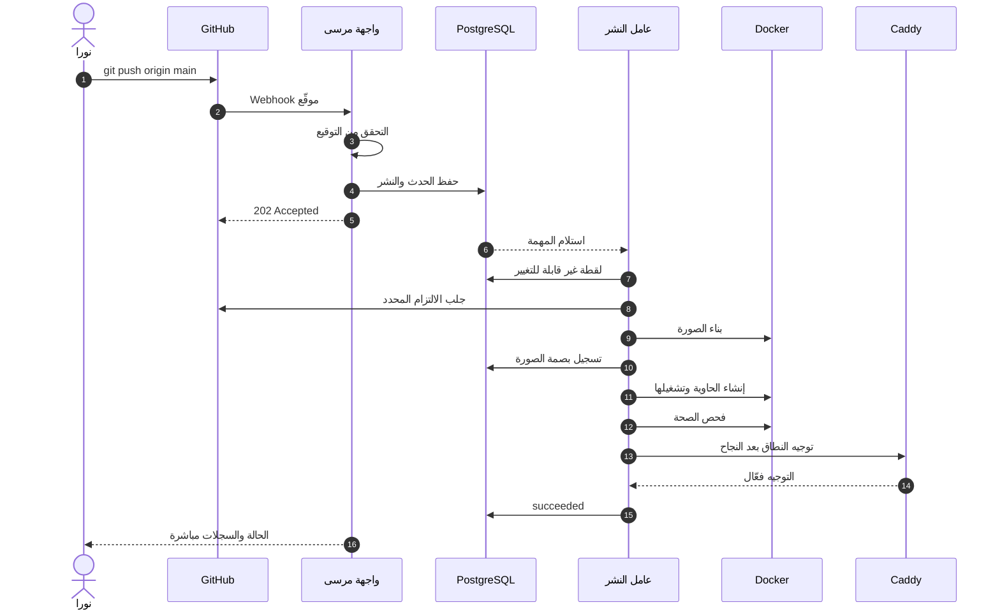
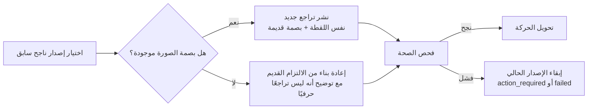
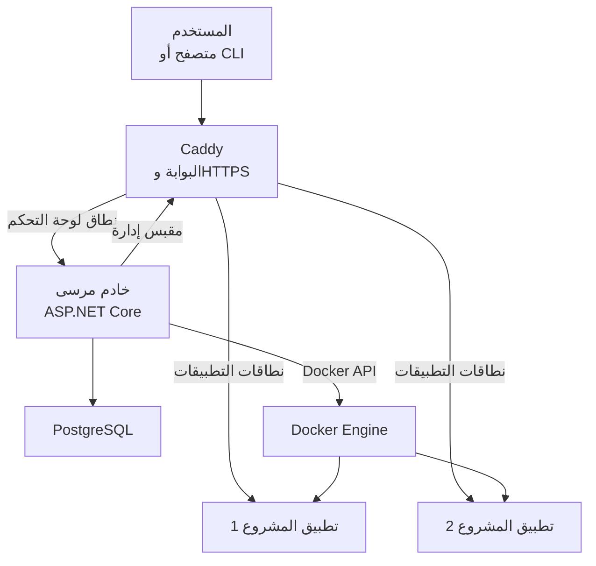
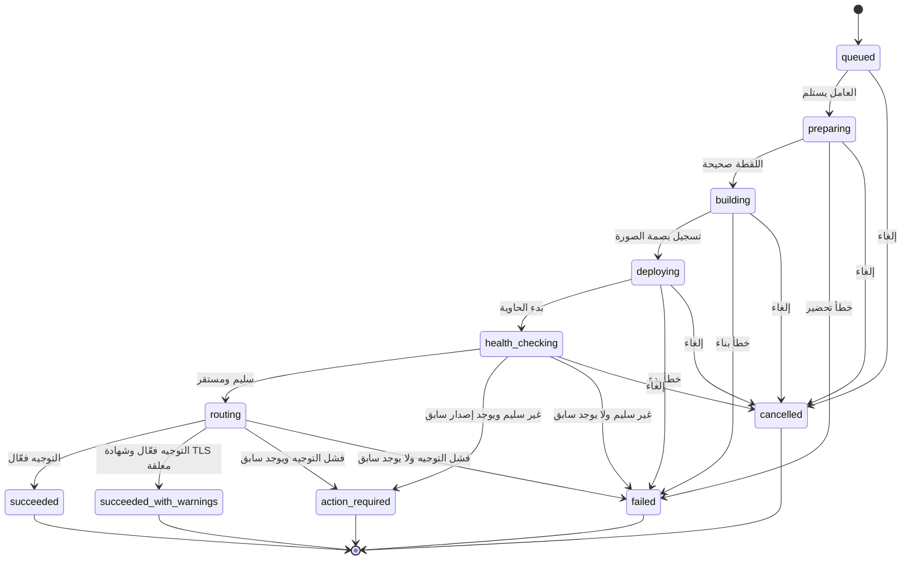

# مرسى: من أول سطر برمجي إلى موقع يعمل

> **حالة المستند:** شرح تعليمي مقترح للنسخة 0.1 من مرسى.
> **آخر تحديث:** 2026-10-22.
> **الجمهور:** مبتدئ يعرف أساسيات البرمجة ويريد فهم كيف يتحول مشروعه إلى تطبيق يعمل على خادم.
> **ملاحظة مهمة:** المستودع الحالي يحتوي على التصميم والوثائق والخطط، وليس على برنامج مرسى جاهز للاستخدام. هذا الدليل يشرح **كيف صُمم مرسى ليعمل**، وليس إعلانًا عن إصدار مكتمل.

---

## 1. لمن كُتب هذا الدليل؟

كُتب هذا الدليل لثلاثة أنواع من القراء:

1. **مطوّر مبتدئ** يعرف كتابة تطبيق صغير، لكنه لا يعرف كيف ينشره على خادم بطريقة آمنة.
2. **مطوّر .NET** يريد منصة يستطيع قراءة كودها وفهمها وتعديلها بلغته.
3. **مستخدم عربي** يريد أن يتعلم النشر بلغته، لا أن يترجم كل خطوة في رأسه.

لا تحتاج إلى خبرة في Kubernetes، ولا في إدارة الشبكات، ولا في كتابة إعدادات Nginx. ستحتاج فقط إلى معرفة عامة بما يلي:

- ما هو **Git** وما معنى **commit** و**push**.
- ما هو **الخادم** وما هو **اسم النطاق**.
- ما معنى **تطبيق ويب** ولماذا له **منفذ**.
- أن **Docker** أداة لتشغيل البرامج داخل وحدات معزولة.

كل مصطلح جديد ستقابله هنا مشروح في [معجم المصطلحات](glossary.ar.md). لا تحاول حفظ المصطلحات كلها في البداية؛ افهم الفكرة، ثم ارجع إلى المعجم عند الحاجة.

---

## 2. الفكرة في ثلاث جمل

1. **مرسى** منصة نشر ذاتية الاستضافة صغيرة، تجعل مستودع Git يتحول إلى تطبيق يعمل على خادم واحد خلف HTTPS.
2. لا تحاول أن تكون منصة ضخمة تفعل كل شيء؛ بل تحاول أن تكون **واضحة وآمنة وقابلة للفهم**.
3. عند النشر، لا يستلم الإصدار الجديد الحركة إلا بعد نجاح فحص الصحة، ويظل الإصدار القديم يعمل حتى يتم التأكد من الجديد.

الاسم **مرسى** يعني المكان الهادئ الذي ترسو فيه السفن. التطبيقات هي السفن، والخادم هو الميناء، ومرسى هو برج المراقبة الذي ينظم دخول السفن وخروجها.

---

## 3. تخيّل ميناءً حقيقياً

قبل الدخول في التفاصيل التقنية، تخيّل أنك تدير ميناءً صغيراً:

| في الميناء | في مرسى |
|---|---|
| سفينة تحمل بضاعة | تطبيقك أو موقعك |
| رصيف مخصص لكل سفينة | مشروع (Project) وبيئة (Environment) |
| حاوية شحن | حاوية Docker (Container) |
| رافعة تبني وتحمّل الحاوية | عامل النشر (Worker) |
| دفتر كبير يسجل كل سفينة وصلت | قاعدة بيانات PostgreSQL |
| حارس البوابة يتأكد من التصاريح | Caddy وطبقة الأمان |
| فحص سلامة السفينة قبل السماح لها بالرسو | فحص الصحة (Health Check) |
| قارب قديم يبقى في الرصيف حتى يرسو الجديد | الإصدار السابق يظل يخدم أثناء النشر |
| سجل الحوادث والتصاريح | سجل التدقيق (Audit) |
| مفتاح الغرفة المحصّنة | المفتاح الرئيسي (Master Key) |

هذه الصورة ليست دقيقة تقنيًا بنسبة 100%، لكنها تعطيك الحدس الصحيح: مرسى لا يبني تطبيقك من الصفر، ولا يستبدل Docker، ولا يخفي الخادم. هو **ينظّم الرحلة** بين هذه الأجزاء، ويجعل كل خطوة مرئية وقابلة للتراجع.

---

## 4. ما هو مرسى بالضبط؟

مرسى هو **لوحة تحكم وحلقة نشر** تعمل على خادم Linux واحد. يستقبل مشروعك من Git، أو صورة جاهزة، ويبني التطبيق، ويشغّله داخل حاوية، ويتأكد من أنه سليم، ثم يوجّه اسم النطاق إليه عبر HTTPS.

### 4.1 ما الذي يفعله مرسى؟

- ينشئ **مشروعاً** ويربطه بمستودع Git أو صورة جاهزة.
- يحاول أن يفهم نوع المشروع تلقائيًا: ASP.NET Core، Node/Next.js، موقع ثابت، Dockerfile، أو صورة جاهزة.
- يبني **صورة (Image)** غير قابلة للتغيير، ويسجل بصمتها (Digest).
- يشغّل **حاوية (Container)** بصلاحيات محدودة.
- يفحص **صحة التطبيق** قبل تحويل الحركة إليه.
- يضيف **اسم النطاق** ويطلب شهادة TLS تلقائيًا عبر Caddy.
- يعرض **المراحل والسجلات** وأسباب الفشل.
- يسمح بعمل **تراجع (Rollback)** صريح إلى إصدار سابق.
- يخزّن **الأسرار** مشفرة، ويخفيها من السجلات.
- يسجل **التدقيق**: من فعل ماذا ومتى.
- يوفر **واجهة ويب** بالعربية والإنجليزية، و**سطر أوامر**، و**API** إصدار `/api/v1`.

### 4.2 ما الذي لا يفعله مرسى في 0.1؟

هذه القائمة مهمة بقدر قائمة ما يفعله. مرسى يرفض التوسع في هذه الاتجاهات في نسخته الأولى:

- لا يدير عدة خوادم أو مجموعة Kubernetes.
- لا يستورد ملفات Docker Compose.
- لا يدير أكثر من خدمة واحدة في النشر الواحد.
- لا ينشئ قواعد بيانات للمستخدمين أو يديرها.
- لا يوفّر متجر تطبيقات أو مئات الخدمات الجاهزة.
- لا يوفّر بريدًا أو استضافة بريد.
- لا يملك تطبيق سطح مكتب أو هاتف.
- لا يسمح لوكيل ذكاء اصطناعي بتغيير الإنتاج تلقائيًا.
- لا يقوم بالتراجع تلقائيًا عند الفشل.
- لا يرسل بيانات استخدام إلى الخارج بشكل صامت.

سبب هذا الضيق ليس نقص الطموح، بل هو قرار تصميمي: **منصة صغيرة يمكن فهمها واختبارها واستعادتها** أفضل من منصة ضخمة لا يعرف أحد كيف تتصرف عند الفشل.

---

## 5. الرحلة الكاملة: من `git push` إلى موقع يعمل

لنتبع قصة **نورا**، وهي مطوّرة تبني متجرًا صغيرًا باستخدام ASP.NET Core. لديها خادم Linux واحد، واسم نطاق `app.example.com`، ومستودع على GitHub.

### 5.1 قبل النشر: التهيئة الأولى

1. تثبّت مرسى على الخادم وفق دليل التثبيت.
2. ينشئ المثبّت **رمز تهيئة لمرة واحدة** ويطبعه على طرفية الخادم أو في ملف بصلاحيات ضيقة.
3. تفتح نورا عنوان لوحة التحكم، وتدخل الرمز، وتنشئ **المؤسسة (Organization)**.
4. تصبح نورا **المالكة (Owner)**، وتستطيع بعد ذلك دعوة أعضاء أو إنشاء رموز وصول.

لا توجد كلمة مرور افتراضية، ولا مسار يسمح لأول زائر بأن يصبح مالكًا. هذا مهم لأن أي خادم متصل بالإنترنت يتعرض لمحاولات آلية مستمرة.

### 5.2 إنشاء المشروع وربط المصدر

1. تنشئ نورا **مشروعاً** اسمه `flower-shop`.
2. تربط المشروع بمستودع GitHub. المستودع عام، لذلك لا تحتاج إلى مفتاح. لو كان خاصًا، لاحتاجت إلى **رمز وصول لمزوّد Git** (مثل GitHub PAT). هذا مختلف عن **رمز مرسى الشخصي (Marsa PAT)** الذي تستخدمه للـAPI وCLI.
3. تختبر نورا الاتصال، فيظهر الفرع الافتراضي `main`.
4. يفحص مرسى المستودع ويقترح خطة بناء:
   - وجد ملف `.csproj` و`Program.cs`؛ إذن هو تطبيق ASP.NET Core.
   - سيبني باستخدام صورة .NET SDK المناسبة.
   - سيشغّل التطبيق على المنفذ 8080.
   - سيستخدم `/health` كمسار فحص الصحة، ويمكن تغييره.

مرسى لا ينفّذ سكربتات المستودع على الخادم أثناء الاكتشاف. الاكتشاف يقرأ ملفات ويعرض **الدليل** الذي بنى عليه قراره. إذا كان التخمين خاطئًا، تستطيع نورا تصحيحه عبر `marsa.json` أو من الواجهة.

### 5.3 أول نشر

تضغط نورا زر **نشر**. ماذا يحدث في الخلفية؟

1. **القبول (Admission):** يتحقق مرسى من الصلاحيات، ومن أن البيئة لا تحتوي على نشر نشط آخر. ينشئ سجل النشر داخل قاعدة البيانات، ويجمّد **لقطة (Snapshot)** لكل ما يحتاجه النشر: الفرع، والالتزام، وخطة البناء، والمنافذ، ومراجع الأسرار.
2. **الطابور:** يدخل النشر حالة `queued`. قد ينتظر لحظات حتى يتوفر عامل.
3. **الاستعداد:** ينتقل إلى `preparing`. يجهّز مساحة عمل خاصة، ويصدّر الالتزام المطلوب فقط، ويستبعد مجلد `.git`.
4. **البناء:** ينتقل إلى `building`. يبني صورة Docker باستخدام BuildKit. كل السجلات تُلتقط وتُنقّى من الأسرار قبل تخزينها. عند النجاح تُسجَّل بصمة الصورة (Digest).
5. **التشغيل:** ينتقل إلى `deploying`. ينشئ حاوية جديدة على شبكة المشروع، بلا وصول إلى Docker socket، وبلا امتيازات، وبحدود CPU وذاكرة.
6. **فحص الصحة:** ينتقل إلى `health_checking`. يطلب مرسى من التطبيق مسار `/health` عدة مرات خلال نافذة زمنية. لا يكفي أن تكون الحاوية „تعمل“؛ يجب أن تستجيب استجابة صحيحة ومستقرة.
7. **التوجيه:** ينتقل إلى `routing`. يطلب مرسى من Caddy تحويل اسم النطاق إلى الإصدار الجديد. يتم ذلك فقط بعد نجاح الفحص.
8. **النجاح:** إذا نجح كل شيء، تصبح الحالة `succeeded`. إذا نجح التوجيه لكن شهادة TLS لم تصدر بعد، تصبح `succeeded_with_warnings`.
9. **الإشعار:** تظهر الحالة في الواجهة مباشرة عبر SignalR، ويمكن قراءتها بعد إعادة تحميل الصفحة من قاعدة البيانات.

### 5.4 ماذا يحدث إذا فشل شيء؟

هنا تكمن أهمية التصميم. الفشل ليس حالة نادرة؛ هو جزء من العمل اليومي.

| مكان الفشل | النتيجة | هل يبقى الموقع القديم يعمل؟ |
|---|---|---|
| فشل التحقق من Webhook | لا يُنشأ نشر | نعم |
| تعارض نشر نشط | `409` مع رمز واضح | نعم |
| فشل البناء | `failed` | نعم |
| فشل بدء الحاوية | `failed` | نعم |
| فشل فحص الصحة ولا يوجد إصدار سابق | `failed` | لا يوجد قديم أصلًا |
| فشل فحص الصحة ويوجد إصدار سابق | `action_required` | نعم |
| فشل التوجيه ويوجد إصدار سابق | `action_required` | نعم |
| فشل شهادة TLS لكن مسار HTTP يعمل | `succeeded_with_warnings` | نعم، مع تحذير |
| إلغاء المستخدم قبل مرحلة التوجيه | `cancelled` | نعم |

**القاعدة الذهبية:** لا يصل الإصدار الجديد إلى المستخدمين إلا بعد نجاح الفحص. الإصدار القديم لا يُوقف لمجرد أن الجديد بُني.

### 5.5 لماذا لا نُرجع تلقائيًا؟

قد تسأل: إذا فشل الجديد، أليس من الأسهل أن يعود مرسى تلقائيًا إلى القديم؟

التراجع التلقائي يبدو ذكيًا، لكنه قد يخفي مشكلة حقيقية ويكررها. ربما فشل الإصدار الجديد لأن قاعدة البيانات تحتاج ترقية، أو لأن إعدادًا مشتركًا خاطئ، أو لأن المشكلة في الخادم نفسه. الرجوع الصامت قد يجعل النظام يبدو سليمًا بينما السبب لم يُصلح.

لذلك في مرسى 0.1:

- الإصدار القديم يظل يخدم.
- النشر يفشل بوضوح.
- **التراجع قرار صريح** من المستخدم، وليس تأثيرًا جانبيًا مخفيًا.
- كل تراجع هو **نشر جديد** يشير إلى صورة قديمة محددة، ويمر بنفس فحص الصحة.

### 5.6 ماذا يعني „التراجع“ حقًا؟

التراجع في مرسى لا يعيد كتابة التاريخ. ينشئ سجل نشر جديدًا، ويستخدم البصمة (Digest) الخاصة بالإصدار السابق. إذا كانت الصورة القديمة قد حُذفت بسبب سياسة الاحتفاظ، فلا يمكن التراجع „حرفيًا“؛ يوضح مرسى أن البديل هو إعادة البناء من الالتزام القديم، وهذا ليس نفس الشيء.

---

## 6. المفاهيم الأساسية التي يجب أن تعرفها

هذه ليست قائمة حفظ، بل خريطة. كل مصطلح له شرح أطول في [المعجم](glossary.ar.md).

### 6.1 Git: دفتر التغييرات

Git يحفظ تاريخ مشروعك. كل **commit** هو لقطة من التغييرات مع رسالة تشرحها. كل **branch** هو خط تطوير مستقل. و**push** يعني إرسال التغييرات إلى مستودع بعيد مثل GitHub.

مرسى لا „يشاهد“ مجلدك على جهازك. هو يقرأ من المستودع البعيد الالتزام المحدد الذي طلبت نشره. هذا يجعل النشر قابلاً للتكرار: نفس الالتزام ونفس الخطة يعطيان نفس النتيجة.

### 6.2 الصورة والحاوية

- **الصورة (Image)** شيء ثابت: ملفات تطبيقك مع بيئة التشغيل، مثل قالب كعكة.
- **الحاوية (Container)** شيء يعمل: نسخة قابلة للتشغيل من تلك الصورة، مثل كعكة مخبوزة.

الصورة تُبنى مرة، ويمكن تشغيل عدة حاويات منها. في مرسى، كل نشر ينتج صورة لبصمة محددة، والحاوية الجديدة تعمل من تلك الصورة.

### 6.3 البيئة والمشروع والخدمة

- **المشروع (Project)**: التطبيق الذي تديره، مثل `flower-shop`.
- **البيئة (Environment)**: سياق التشغيل، مثل الإنتاج أو التجربة. في 0.1، لكل مشروع بيئة واحدة وخدمة واحدة.
- **الخدمة (Service)**: العملية القابلة للنشر. في 0.1، خدمة واحدة لكل نشر.

هذا التبسيط مقصود. المشاريع الحقيقية قد تحتوي على واجهة وخدمة خلفية وقاعدة بيانات، لكن دعم ذلك يحتاج نموذجًا مختلفًا للشبكات والتوجيه واللقطات. مرسى يؤجله بدل أن يضيف تعقيدًا غير مكتمل.

### 6.4 النشر والإصدار

- **النشر (Deployment)** هو المحاولة: حدث له حالة، وخطوات، وسجلات، ونتيجة.
- **الإصدار (Release)** هو النتيجة الناجحة: صورة محددة تعمل وتخدم الحركة.

قد تفشل محاولات نشر كثيرة، لكن يبقى الإصدار السابق هو الذي يخدم. هذا الفصل مهم للتدقيق والتراجع.

### 6.5 اللقطة غير القابلة للتغيير

عند قبول النشر، يجمّد مرسى كل ما يحتاجه في **لقطة (Snapshot)**: الالتزام، خطة البناء، المنفذ، مسار الصحة، مراجع الأسرار، وإعدادات أخرى.

لماذا؟ لأنك قد تعدّل إعدادات المشروع بعد بدء النشر. لو قرأ العامل الإعدادات الحية، فقد يبني نصفًا بإعداد قديم ونصفًا بإعداد جديد. اللقطة تضمن أن النشر الذي بدأه المستخدم هو النشر الذي ينفّذه العامل.

### 6.6 فحص الصحة

الحاوية التي „تعمل“ ليست بالضرورة جاهزة. قد تكون في حلقة إعادة تشغيل، أو تنتظر قاعدة بيانات، أو تستمع على المنفذ الخطأ.

**فحص الصحة (Health Check)** هو طلب متكرر إلى التطبيق، مثل `GET /health`. يحدد مرسى:
- المسار والمنفذ.
- الفاصل بين المحاولات.
- المهلة لكل محاولة.
- عدد المحاولات.
- فترة السماح لبدء التطبيق.
- عدد النجاحات المتتالية المطلوبة للاستقرار.

في التصميم الافتراضي: 60 ثانية إجمالًا، كل 5 ثوانٍ، بمهلة 3 ثوانٍ، و12 محاولة، مع 10 ثوانٍ فترة بدء، و3 نجاحات متتالية.

### 6.7 التوجيه وCaddy

**Caddy** هو الخادم الذي يقف عند بوابة الميناء. يستقبل طلبات HTTPS من الإنترنت، ويفك التشفير، ثم يمرر الطلب إلى التطبيق المناسب.

مرسى لا يسمح بالوصول إلى لوحة إدارة Caddy عبر منفذ عام. يتحكم بها عبر **مقبس Unix (Unix Socket)** محلي فقط. هذا يقلل سطح الهجوم: لا يستطيع أي تطبيق على الشبكة أن يغيّر مساراتك.

### 6.8 الأسرار والتشفير المغلف

**السر (Secret)** هو قيمة لا يجب أن تظهر: كلمة مرور قاعدة بيانات، مفتاح API، أو مفتاح توقيع.

مرسى لا يخزّن السر كنص واضح. يستخدم **تشفيرًا مغلفًا (Envelope Encryption)**:
1. يُشفَّر كل سر بمفتاح بيانات.
2. يُشفَّر مفتاح البيانات بدوره بمفتاح رئيسي.
3. يُحفظ المفتاح الرئيسي خارج قاعدة البيانات وخارج صورة التطبيق.

إذا سُرقت نسخة من قاعدة البيانات وحدها، فلن يستطيع المهاجم فك الأسرار بدون المفتاح الرئيسي. ولهذا يجب نسخ المفتاح الرئيسي احتياطيًا بشكل منفصل؛ النسخة الاحتياطية من قاعدة البيانات بدون المفتاح لا تكفي.

### 6.9 سجل التدقيق

**التدقيق (Audit)** سجل لا يُعدَّل من التطبيق: من سجّل الدخول، من غيّر مشروعًا، من نشر، من تراجع، من عدّل سرًا، ومتى.

السجل لا يحتوي قيم الأسرار. فائدته أنك تستطيع الإجابة عن سؤال „من فعل ذلك؟“ دون الاعتماد على ذاكرة أحد.

### 6.10 العامل وعقد الإيجار

**العامل (Worker)** هو الجزء الذي ينفّذ النشر في الخلفية. قد يتعطل أثناء البناء أو الفحص.

لذلك يستخدم مرسى **عقد إيجار (Lease)**: العامل يحجز المهمة لمدة محددة، ويجدد الحجز عبر **نبضة قلب (Heartbeat)**. إذا مات العامل، ينتهي الإيجار، ويمكن لعامل آخر أن يستأنف أو يفشل المهمة بشكل محدد. هذا يمنع نشرين متوازيين لنفس البيئة.

### 6.11 إعادة المحاولة الآمنة

**Idempotency** تعني أن إعادة إرسال الطلب نفسه لا تُنشئ أثرًا مكررًا. إذا ضغطت „نشر“ مرتين بسبب بطء الشبكة، لا تريد نشرين.

مرسى يستخدم **مفتاح Idempotency**: نفس المفتاح ونفس الطلب يعيدان النتيجة الأصلية. هذا مفهوم صغير لكنه يمنع فوضى كبيرة عند إعادة المحاولة.

### 6.12 التسوية

**التسوية (Reconciliation)** تعني مقارنة „ما نريد أن يكون“ في قاعدة البيانات مع „ما هو موجود فعلاً“ في Docker وCaddy، ثم إصلاح الفرق.

إذا أُعيد تشغيل Caddy وفقد مساراته المؤقتة، يستطيع مرسى إعادة بناء المسارات من قاعدة البيانات. لكنه لا يلمس أي حاوية أو مسار لا يحمل علاماته (`io.marsa.*`).

---

## 7. كيف تبدو البنية؟

### 7.1 الأجزاء الخمسة

| الجزء | دوره | ما لا يفعله |
|---|---|---|
| **Caddy** | البوابة العامة، TLS، والتوجيه | لا يتخذ قرارات نشر، ولا يقرأ قاعدة البيانات |
| **خادم مرسى** | API، الواجهة، SignalR، العامل | لا يخدم حركة التطبيقات مباشرة |
| **PostgreSQL** | الحالة الدائمة، الأسرار المشفرة، سجلات التدقيق، طابور العمل | لا يخزّن أسرارًا كنص واضح |
| **Docker** | بناء الصور وتشغيل الحاويات | لا يمنح الحاويات وصولًا إلى نفسه |
| **التطبيقات** | كود المستخدم | لا تصل إلى Docker socket أو ملفات الخادم |

### 7.2 لماذا PostgreSQL فقط؟

لأن كل اعتماد إضافي على Redis أو Kafka أو مخزن كائنات هو:
- نسخة احتياطية إضافية،
- ترقية إضافية،
- فشل محتمل إضافي،
- وسطح هجوم إضافي.

مرسى يستخدم PostgreSQL لكل شيء تقريبًا: البيانات، الطابور، عقود الإيجار، صندوق الصادر (Outbox)، والتدقيق. هذا يحدّ من عدد الأجزاء التي يجب على شخص واحد تشغيلها.

الثمن أن هذا التصميم له سقف في التوسع الأفقي. لكن النسخة 0.1 تستهدف خادمًا واحدًا وفريقًا صغيرًا، لا آلاف المستخدمين المتزامنين.

### 7.3 لماذا خادم واحد؟

لأن تعدد الخوادم يغيّر طبيعة المنتج: توزيع الحمل، فشل الشبكة، اتساق القرار، ونسخ الحالة. هذه مشكلات حقيقية لا تُحل بإضافة زر.

مرسى يبدأ بمضيف واحد لأنه يستطيع أن يكون **صادقًا** بشأن حدوده. إذا احتجت لاحقًا إلى عدة مضيفين، فهذا قرار معماري جديد، لا مجرد إعداد.

---

## 8. دورة حياة النشر

لكل نشر حالة واحدة في كل لحظة. لا يوجد „نصف نجاح“ غامض.

| الحالة | المعنى |
|---|---|
| `queued` | النشر محفوظ وينتظر عاملًا |
| `preparing` | تجهيز المصدر والتحقق من اللقطة |
| `building` | بناء صورة التطبيق |
| `deploying` | إنشاء الحاوية وتشغيلها |
| `health_checking` | فحص الصحة والاستقرار |
| `routing` | تحويل النطاق إلى الإصدار الجديد |
| `succeeded` | نجاح كامل |
| `succeeded_with_warnings` | نجاح مع تحذير غير قاتل، مثل شهادة TLS معلقة |
| `action_required` | يحتاج المستخدم قرارًا؛ الإصدار السابق غالبًا يخدم |
| `failed` | فشل نهائي |
| `cancelled` | أُلغي بأمان |

### 8.1 قواعد لا تتغير

- لا رجوع إلى حالة سابقة؛ الحالة تتقدم فقط.
- الحالات النهائية لا تُعدّل.
- يمكن الإلغاء من `queued` حتى `health_checking`، لكن ليس أثناء `routing` لأنه قصير وحاسم.
- الفشل لا يستدعي تراجعًا تلقائيًا.
- إعادة المحاولة تنشئ نشرًا جديدًا أو تزيد عدّاد المحاولات؛ لا تعيد الحالة إلى الوراء.

---

## 9. الأمان: لماذا هذه التفاصيل مهمة؟

قد تظن أن الأمان موضوع منفصل عن „كيف أنشر تطبيقي“. لكن في منصة نشر، الأمان هو **شرط أساسي** لعمل المنتج.

### 9.1 Docker socket: أخطر اتصال في النظام

خادم مرسى يحتاج إلى التحدث مع Docker ليبني ويشغّل الحاويات. هذا الاتصال يمر عبر **Docker socket**، وهو ملف خاص يمنح من يملكه سلطة شبه كاملة على الخادم.

لماذا؟ لأن من يستطيع إنشاء حاوية privileged، أو تركيب مجلد الخادم داخلها، يستطيع الوصول إلى ملفات النظام وكأنه root.

لذلك:

- الحاويات التي تشغّل تطبيقك **لا** تحصل على Docker socket.
- البناء **لا** يحصل عليه.
- لا تُقبل خيارات مثل `--privileged` أو `--network host` أو تركيب `/` أو `/var/run/docker.sock` من المستخدم.
- مرسى يرفض التعديل على أي حاوية لا تحمل علاماته.
- هذا الخطر موثق بوضوح، ولا يُخفى تحت عبارة „آمن“.
- العامل الذي يدير Docker يُعد جزءًا من نطاق الثقة؛ اختراقه يعني اختراق الخادم.

### 9.2 Caddy admin socket

Caddy يستطيع تغيير مسارات كل المواقع. لو تُرك منفذ الإدارة (`2019`) مفتوحًا، لأصبح أي طرف قادر على سرقة الحركة أو توجيهها.

لذلك:

- الإدارة عبر `/run/marsa/caddy/admin.sock` فقط.
- صلاحيات المجلد `0700` والمقبس `0660`.
- لا مستمع TCP للإدارة.
- التغييرات تُسلسل، وتُطبّق كمجموعة مسارات كاملة، وتُحفظ المسارات الأجنبية.

### 9.3 الأسرار

- لا تُعاد الأسرار من واجهات القوائم.
- لا تُكتب في السجلات أو الأحداث أو سجل التدقيق.
- تُحقن في الحاوية عند الإنشاء فقط.
- يمكن تدوير السر، فيستخدمه النشر التالي، بينما تحتفظ الإصدارات القديمة بلقطاتها.
- اختبار „canary“ يزرع قيمة سرية وهمية ويتأكد من عدم ظهورها في أي مخرج.

### 9.4 الهوية والصلاحيات

- لا كلمة مرور افتراضية.
- تهيئة أولى برمز لمرة واحدة.
- جلسات عبر كوكيز `HttpOnly` و`Secure` في الإنتاج و`SameSite=Lax`.
- عمليات التغيير عبر الكوكي تتطلب حماية CSRF.
- رموز مرسى الشخصية (Marsa PAT) تُخزّن كبصمة hash، وتُعرض مرة واحدة.
- الأدوار: مالك، مدير، مطوّر، مشاهد.
- كل استعلام لمورد تابع لمؤسسة يجب أن يكون محصورًا بها.
- محاولة الوصول إلى مؤسسة أخرى لا تكشف حتى وجود المورد.

### 9.5 ماذا لا يستطيع مرسى حمايته؟

الأمان ليس سحرًا. إذا كان الخادم نفسه مخترقًا، أو كان kernel به ثغرة، أو كان المستخدم يركّب صورة ضارة، فقد تُخترق الحاوية أو الخادم. مرسى يقلل سطح الهجوم ويوثق الحدود؛ لكنه لا يستطيع أن يعدك بسلامة مطلقة.

---

## 10. لماذا هذه التقنيات؟

### 10.1 .NET 10 وC# 14

- لغة واحدة للخادم والاختبارات وأدوات CLI.
- يمكن لمطوّر .NET قراءة الكود وتصحيحه بأدواته المعتادة.
- ASP.NET Core مناسب للواجهة من الخادم وSignalR وواجهات API.
- Razor Components تعني واجهة بدون حاجة إلى بناء Node/SPA منفصل.

**التنازل:** مجتمع .NET أصغر من مجتمع JavaScript في أدوات النشر، وبعض تكاملات Docker/Caddy تحتاج عملًا إضافيًا.

### 10.2 PostgreSQL 17

- قاعدة بيانات علائقية ناضجة.
- تدعم القيود التي تفرض الثوابت، مثل نشر نشط واحد لكل بيئة.
- يمكن استخدامها كطابور عمل عبر `FOR UPDATE SKIP LOCKED`.
- تقلل عدد المكونات التي تحتاج نسخًا احتياطيًا.

**التنازل:** لا يوجد Redis أو طابور موزع؛ السقف أقل، والفشل له خصائص مختلفة.

### 10.3 Caddy 2.x

- HTTPS تلقائي عبر ACME.
- إعداد بسيط نسبيًا.
- إدارة عبر Unix socket.
- يمكنه العمل كحافة واحدة لكل النطاقات.

**التنازل:** لسنا نبني وكيلًا عكسيًا عامًا لكل حالات الاستخدام؛ بعض الإعدادات المتقدمة قد لا تكون متاحة.

### 10.4 Docker

- البناء والتشغيل متسقان إلى حد كبير.
- عزل العمليات والشبكات والموارد.
- يمكن تشغيل التطبيقات بأي لغة داخل صورة.

**التنازل:** Docker socket خطير، والصور الضارة تعني تنفيذ كود. لا توجد عزلة مطلقة.

---

## 11. مرسى مقابل Openship وCoolify وDokku

هذا الجدول **ليس حكمًا نهائيًا** بأن مرسى أفضل. مرسى لم يُطلق بعد، وهذه المشاريع أكثر نضجًا منه في نواحٍ كثيرة. المعلومات هنا مبنية على صفحات عامة وتحليل سابق بتاريخ 2026-10-22، وليست اختبارًا عمليًا.

| الأداة | شكلها | ما تجيده | الثمن أو التنازل | الترخيص | علاقتها بمرسى |
|---|---|---|---|---|---|
| **Openship** | منصة استضافة ذاتية واسعة: Git، Compose، خدمات متعددة، قواعد بيانات، بريد، نطاقات، سجلات، تراجع، CLI، سطح مكتب، MCP | الاتساع وتعدد الواجهات والخدمات | سطح كبير للتعلّم والتشغيل؛ بيئة TypeScript/Node؛ محرك البريد له حدود GPLv3؛ افتراضات متعددة الخوادم | Apache-2.0 للمنصة مع حدود GPLv3 لمحرك البريد | أقرب منافس „واسع“. مرسى لا يحاول التفوق عليه في عدد الميزات |
| **Coolify** | منصة PaaS ذاتية ناضجة: تطبيقات Docker، قواعد بيانات، مئات الخدمات الجاهزة، عدة خوادم، نسخ احتياطي، معاينات، API | الاكتمال والنظام البيئي والمجتمع | اتساع وتعقيد إعداد؛ PHP/Laravel؛ ليست .NET-first ولا عربية-first | Apache-2.0 | الخيار الافتراضي لمن يريد „كل شيء“. مرسى يريد أن يكون الخيار الأهدأ لا الأكبر |
| **Dokku** | PaaS صغير بأسلوب Heroku: `git push`، Buildpacks أو Dockerfile، إضافات، CLI أولًا | نواة صغيرة وتاريخ طويل وتوسّع عبر الإضافات | لا لوحة تحكم مدمجة في النواة مفتوحة المصدر؛ بعض ميزات الفريق مدفوعة | MIT | يثبت أن نواة صغيرة يمكن أن تعيش. مرسى يأخذ الانضباط لا الواجهة |
| **مرسى** (مقترح) | ميناء صغير لخادم Linux واحد: Git إلى HTTPS، مراحل واضحة، تراجع آمن، أسرار، تدقيق، CLI وواجهة عربية | .NET-native، العربية/RTL أولًا، حالة نشر واضحة، اعتماديات قليلة | ميزات أقل، مجتمع أصغر، لا تعدد خوادم، لا Compose | Apache-2.0 مقترح | يجب أن ينافس على الفهم والثقة، لا على طول قائمة الميزات |

### 11.1 أين لا يتفوق مرسى؟

- **اتساع الخدمات الجاهزة:** Coolify يتفوق بفارق كبير.
- **تعدد الخوادم:** Coolify وOpenship أكثر نضجًا.
- **Compose والخدمات المتعددة:** Openship وCoolify.
- **إدارة قواعد البيانات:** ليست من نطاق مرسى 0.1.
- **حجم المجتمع:** مرسى يبدأ من الصفر.
- **تطبيقات JavaScript/Next.js:** أدوات مثل DeployWise وVercel قد تكون أسهل في البداية.
- **الجاهزية للمؤسسات الكبيرة:** SSO وSCIM والتقارير ليست في 0.1.

### 11.2 أين قد يكون مرسى مختلفًا؟

- مطوّر .NET يستطيع قراءة المنصة نفسها، لا استخدامها فقط.
- تجربة عربية حقيقية، لا ترجمة في النهاية.
- مسار نشر واحد واضح، بدل مئات الخيارات.
- اعتماديات قليلة يمكن لشخص واحد نسخها احتياطيًا واستعادتها.
- فشل مفهوم: المرحلة، السبب، الدليل، والخطوة التالية.

هذه فرضيات تحتاج تحققًا مع مستخدمين حقيقيين. لا تعتبرها حقائق مثبتة.

---

## 12. كيف يُبنى مرسى بمساعدة الوكلاء؟

هذا المشروع مكتوب ليكون مفهومًا للبشر **و**لوكلاء الذكاء الاصطناعي. لكن العمل مع وكيل لا يعني „اطلب تطبيقًا كاملًا“. يعني أن تعطيه سياقًا دقيقًا وحدودًا واضحة.

### 12.1 الوثائق هي العقد

كل قرار مهم له مكان:

- **المتطلبات:** ماذا يجب أن يفعل المنتج، ومعرّفات ثابتة مثل `FR-DEP-05`.
- **قرارات الهندسة (ADR):** لماذا اخترنا هذا الحل، وما البدائل المرفوضة.
- **الخارطة:** ترتيب البناء وأهداف كل مرحلة.
- **المهام (Issues):** قطعة عمل صغيرة لها معايير قبول واعتماديات.
- **`AGENTS.md`:** القواعد التي لا يجوز للوكيل خرقها.

### 12.2 كيف يعمل الوكيل على مهمة؟

1. يقرأ الحالة الحالية في `docs/00-progress.md`.
2. يقرأ المهمة وكل المهام التي تعتمد عليها.
3. يقرأ المتطلبات وADR المرتبطة.
4. يكتب خطة قصيرة: الملفات، الاختبارات، الخطر، وما هو خارج النطاق.
5. ينفّذ أصغر شريحة رأسية تحقق معايير القبول.
6. يشغّل الاختبارات، ويصلح الفشل.
7. يحدّث الوثائق والسجل إن تغيّر السلوك.
8. يعرض الأدلة، لا يقول „تم“ دون إثبات.

### 12.3 ما لا يفعله الوكيل

- لا يدفع إلى GitHub أو ينشئ Issues دون إذن.
- لا يغيّر قرارًا معماريًا معتمدًا بصمت.
- لا يطبع أسرارًا أو يضعها في الاختبارات.
- لا يخترع نطاقًا عامًا أو حكمًا قانونيًا.
- لا يقول إن اختبارًا نجح إذا لم يشغّله.
- لا يتجاوز حدود خدمة واحدة، أو خادم واحد، أو PostgreSQL-only.

### 12.4 لماذا هذا مهم للمبتدئ؟

لأن الوكيل يستطيع أن يكتب كودًا بسرعة، لكنه يستطيع أيضًا أن يخترع واجهات غير موجودة، أو يخفي فشلًا، أو يوسّع النطاق. الوثائق والاختبارات والمراجعة البشرية هي ما يحوّل „كودًا سريعًا“ إلى منتج يمكن الوثوق به.

---

## 13. خارطة الطريق: كيف يُبنى مرسى؟

الخارطة مقسمة إلى سبع مراحل. كل مرحلة تنتج شيئًا يمكن عرضه واختباره، وليست طبقة نظرية.

| المرحلة | الهدف | معيار الخروج |
|---|---|---|
| **M0** | الهيكل العظمي | مستودع نظيف يُبنى ويختبر، ويبدأ مع PostgreSQL وCaddy، ويخدم `/health/live` و`/health/ready` |
| **M1** | التهيئة والهوية | مالك يكمل التهيئة ويسجّل الدخول، واختبارات العزل والأدوار تنجح |
| **M2** | المشاريع والاكتشاف والبناء | ربط مستودع مدعوم، اكتشاف يشرح خطته، وبناء ينتج صورة ببصمة |
| **M3** | النشر والمراقبة | إصدار يبدأ ويجتاز الصحة، وتظهر حالته مباشرة، وفشل الصحة لا يغيّر المسار |
| **M4** | التوجيه والأمان | نطاق موثّق يخدم HTTPS، والإصدار الفاشل لا يستلم حركة، والأسرار مشفرة |
| **M5** | التشغيل والاستعادة | تراجع، تدوير سر، تدقيق، وCLI وواجهة عربية تكمل المسار الأساسي |
| **M6** | مرشح الإصدار | تثبيت على خادم نظيف، ترقية، نسخ احتياطي واستعادة، E2E، SBOM، وأدلة تشغيل |

### 13.1 لماذا هذا الترتيب؟

- **M0 أولًا:** لو كان البناء أو الترحيل أو فحص الصحة معطلًا، فلا قيمة لأي ميزة لاحقة.
- **M1 قبل المصادر:** الأدوار والعزل والتهيئة حدود؛ إضافتها لاحقًا مكلفة.
- **M2 قبل التوجيه:** توجيه نطاق إلى صورة لا تُبنى ليس نشرًا.
- **M3 قبل TLS:** صحة القطع أهم من قصة الشهادة.
- **M4 قبل واجهة التراجع:** لا تراجع بلا إصدار سابق سليم ومسار مستقر.
- **M5 قبل المرشح:** العربية والتراجع والتدقيق ليست تجميلًا.
- **M6 بوابة:** التصلّب وأدلة التشغيل تُبنى تدريجيًا، لكنها تُثبت قبل الإطلاق.

---

## 14. ماذا يعني هذا لك كمبتدئ؟

### 14.1 ما يجب أن تتعلمه قبل استخدام مرسى

لا تحتاج إلى أن تصبح خبيرًا، لكن هذه المفاهيم ستجعل تجربتك أفضل:

1. **Git:** الالتزام، الفرع، الدفع، والدمج.
2. **Docker:** الفرق بين الصورة والحاوية، وكيف تقرأ `Dockerfile`.
3. **DNS:** كيف يشير النطاق إلى خادمك.
4. **HTTPS:** أن الشهادة تثبت هوية الموقع وتشفّر الاتصال.
5. **المنافذ:** أن التطبيق يستمع على منفذ، وأن الجدار الناري يتحكم بالوصول.
6. **السجلات:** كيف تقرأ رسالة خطأ بدل أن تخمّن.
7. **النسخ الاحتياطي:** أن البيانات بلا نسخة احتياطية قابلة للاستعادة ليست بيانات.

### 14.2 أول تجربة نشر: الخط العام

1. ثبّت مرسى على خادم Linux نظيف.
2. احصل على رمز التهيئة من الخادم.
3. أنشئ حساب المالك والمؤسسة.
4. أضف مشروعًا واربط مستودعك.
5. راجع خطة الاكتشاف: هل نوع المشروع والمنفذ ومسار الصحة صحيحة؟
6. أضف اسم النطاق، واتبع تعليمات DNS التي تظهر لك.
7. اضغط نشر.
8. راقب المراحل: التحضير، البناء، التشغيل، الصحة، التوجيه.
9. إذا فشل شيء، اقرأ اسم الخطوة ورمز الخطأ والخطوة التالية.
10. بعد النجاح، جرّب إصدارًا جديدًا، ثم جرّب التراجع في بيئة تجريبية.

### 14.3 علامات أن النشر سليم

- الحالة `succeeded` أو `succeeded_with_warnings` مع سبب واضح للتحذير.
- المسار يشير إلى الإصدار الجديد.
- الشهادة فعالة، أو توجد حالة معلقة مفهومة.
- السجلات لا تحتوي أسرارًا.
- الإصدار السابق ما زال محفوظًا ضمن سياسة الاحتفاظ.
- يمكنك قراءة سبب أي فشل دون SSH.

---

## 15. أسئلة شائعة

### هل مرسى بديل لـ Docker؟

لا. Docker هو محرك البناء والتشغيل. مرسى طبقة تنسيق وتحكم فوقه. أنت ما زلت تحتاج إلى Docker على الخادم.

### هل مرسى بديل لـ Kubernetes؟

لا. Kubernetes يوزّع الحاويات على عدة خوادم ويعالج حالات فشل موزعة. مرسى يبدأ بخادم واحد عن قصد.

### هل هو PaaS؟

يمكن وصفه بأنه „منصة نشر ذاتية الاستضافة“ أو PaaS صغير. لكنه لا يقدّم متجر خدمات أو إدارة قواعد بيانات أو تعدد خوادم.

### هل يدعم تطبيقات PHP أو Python أو Go؟

في 0.1، الاكتشاف الأصلي يدعم ASP.NET Core وNode/Next.js والمواقع الثابتة وDockerfile والصور الجاهزة. يمكن تشغيل لغات أخرى عبر Dockerfile، لكنها ليست مسارًا مُكتشفًا رسميًا.

### هل يقوم بالتراجع تلقائيًا؟

لا. الإصدار القديم يظل يخدم، والتراجع قرار صريح. السبب أن التراجع التلقائي قد يخفي سبب الفشل.

### هل يمكن استخدامه على Windows؟

لا. النسخة 0.1 تستهدف خوادم Linux فقط، مع معمارية x86_64 أو arm64.

### هل يرسل بياناتي إلى السحابة؟

لا توجد تلمترية صامتة. التصدير إلى OpenTelemetry اختياري ومُعطّل افتراضيًا. لكن الخادم يحتاج إلى اتصال خارجي بـ Git ومستودع الصور وACME عند الحاجة.

### هل يدعم أكثر من اسم نطاق؟

في 0.1: اسم نطاق واحد موثّق لكل خدمة، ولا wildcard. الأسماء المتعددة مؤجلة.

### هل يمكنني استعادة الأسرار بعد كارثة؟

فقط إذا احتفظت بالمفتاح الرئيسي. النسخة الاحتياطية من قاعدة البيانات وحدها لا تكفي. هذا شرط يجب أن يعرفه المشغّل قبل الحادث.

### هل المشروع جاهز للاستخدام الآن؟

لا. المستودع الحالي وثائق وتصميم. الإصدار 0.1 لم يُبنَ بعد. هذا الدليل يشرح التصميم، وليس منتجًا مكتملًا.

---

## 16. اختبر فهمك: عشرة أسئلة

حاول الإجابة قبل فتح الحل.

### السؤال 1

ما الفرق بين **الصورة (Image)** و**الحاوية (Container)**؟

الإجابة

الصورة قالب ثابت يحتوي ملفات التطبيق وبيئة التشغيل. الحاوية نسخة قابلة للتشغيل من هذه الصورة. في مرسى، البناء ينتج صورة ببصمة محددة، والتشغيل ينشئ حاوية منها.

### السؤال 2

لماذا يجمّد مرسى **لقطة (Snapshot)** قبل بدء النشر؟

الإجابة

حتى لا تتغير خطة النشر إذا عدّل المستخدم إعدادات المشروع أثناء التنفيذ. اللقطة تضمن أن كل خطوة تعمل على نفس الالتزام والإعدادات والأسرار التي وافق عليها القبول.

### السؤال 3

ماذا يحدث إذا فشل فحص الصحة ويوجد إصدار قديم يعمل؟

الإجابة

يبقى الإصدار القديم يخدم الحركة، وتصبح حالة النشر `action_required` لأن الإنسان يحتاج إلى قرار. لا يُوجَّه النطاق إلى الإصدار الجديد، ولا يحدث تراجع تلقائي.

### السؤال 4

لماذا لا تحصل الحاويات على Docker socket؟

الإجابة

لأن الوصول إلى Docker socket يمنح سلطة شبه كاملة على الخادم. أي تطبيق يملكه قد ينشئ حاوية privileged أو يركّب ملفات النظام. لذلك يُعزل التطبيق عن هذا الاتصال، ويبقى لدى خادم مرسى وحده.

### السؤال 5

ماذا تعني **Idempotency** في سياق النشر؟

الإجابة

أن إعادة إرسال الطلب نفسه لا تُنشئ نشرًا مكررًا. إذا أعاد المتصفح إرسال الطلب بسبب بطء الشبكة، يعيد مرسى النتيجة الأصلية بدل إنشاء محاولة ثانية.

### السؤال 6

لماذا يُعد التراجع **نشرًا جديدًا** وليس تعديلًا للتاريخ؟

الإجابة

لأن التاريخ يجب أن يبقى صادقًا. التراجع يستخدم صورة قديمة محددة ويمر بنفس فحص الصحة، ويُسجَّل كحدث جديد. لا نمحو النشر الفاشل ولا نعيد كتابة الحالة السابقة.

### السؤال 7

لماذا يدير مرسى Caddy عبر Unix socket بدل منفذ TCP؟

الإجابة

لأن من يتحكم في Caddy يستطيع تغيير مسارات كل المواقع. مقبس Unix محلي بصلاحيات محددة لا يُعرَض على الشبكة، فيقل سطح الهجوم. لا يوجد مستمع إدارة TCP عام.

### السؤال 8

ما دور PostgreSQL في مرسى؟

الإجابة

هو الحالة الدائمة الوحيدة المطلوبة: المشاريع، النشرات، اللقطات، السجلات، الأسرار المشفرة، التدقيق، الطابور، وعقود الإيجار. لا يوجد Redis أو وسيط رسائل منفصل في 0.1.

### السؤال 9

لماذا لا تكون العربية مجرد „ترجمة“ في مرسى؟

الإجابة

لأن العربية تؤثر في اتجاه الصفحة، والخطوط، والأرقام، والنماذج، والسجلات، ورسائل الخطأ. الترجمة الحرفية قد تنتج واجهة مكسورة. مرسى يعتبر RTL واختبار العرض على 360 و1280 بكسل جزءًا من معايير القبول.

### السؤال 10

متى تحتاج إلى Dockerfile بدل الاكتشاف التلقائي؟

الإجابة

عندما لا يستطيع مرسى فهم طريقة بناء مشروعك، أو عندما تحتاج خطوات بناء خاصة، أو لغة غير مدعومة أصلًا، أو تحكمًا دقيقًا في الصورة. `Dockerfile` يمنحك تحكمًا أكبر، لكنه يزيد مسؤوليتك عن الأمان وكفاءة الصورة.

---

## 17. المصطلحات والوثائق التالية

كل مصطلح تقريبًا في هذا الدليل له تعريف مستقل في:

- [معجم مرسى العربي](glossary.ar.md) — تعريف كل مصطلح، ولماذا يهم في مرسى.

للتعمق:

- [الرؤية والرسالة](../00-vision.md)
- [متطلبات المنتج](../01-product-requirements.md)
- [التميّز والمنافسة](../02-differentiation.md)
- [الهندسة المعمارية](../03-architecture.md)
- [الأمان](../07-security.md)
- [خارطة الطريق](../08-roadmap.md)
- [حالة المشروع الحالية](../00-progress.md)
- [دليل الوكلاء](../../AGENTS.md)

---

## 18. الخلاصة

مرسى ليس محاولة لبناء „Coolify آخر“ بعدد ميزات أكبر. هو محاولة لبناء **ميناء صغير مفهوم**:

- يستقبل الكود من Git.
- يبني صورة ثابتة.
- يشغّل حاوية محدودة الصلاحيات.
- يتأكد من صحتها.
- يوجّه النطاق إليها بعد النجاح فقط.
- يحتفظ بالقديم حتى يثبت الجديد.
- يعرض ما حدث بلغة مفهومة.
- يسمح بالتراجع صراحة.
- يحمي الأسرار ويترك أثرًا للتدقيق.
- يشرح نفسه بالعربية.

إذا كنت مبتدئًا، فلا تحاول فهم كل التفاصيل مرة واحدة. ابدأ بالصورة الكبيرة: **كود ← بناء ← حاوية ← فحص ← توجيه ← نجاح**. ثم عد إلى كل جزء عندما تحتاجه.

وإذا كنت تساهم في المشروع، فتذكّر القاعدة الأهم: **الوضوح والأمان والصدق في الفشل أهم من عدد الميزات**.
